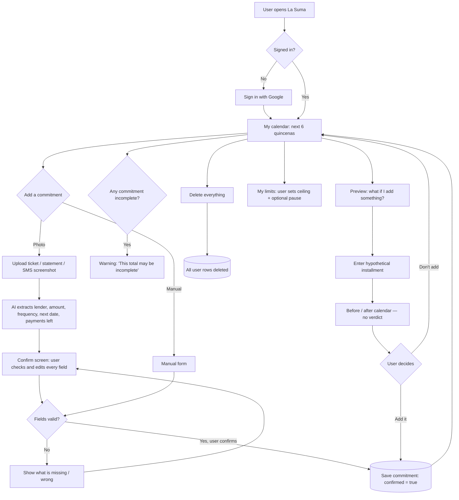
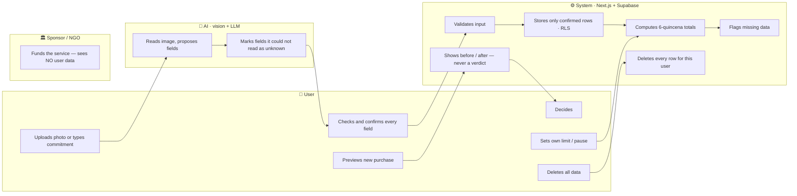

# PACKET — La Suma
**Business Bending · Week 10 — Isle of Happiness**
Rafael Pieck Guerra · Role: USER · Vacuum: Debt guardrails · October 2026

> Packet before code. This file was committed before any application code.

---

## 1. Problem (in my words)

In Mexico, every installment looks affordable on its own: "only 200 a month," a Coppel abono, a 6-MSI cut, a Kueski payment. Nobody adds them up — not the store, not the bank, and usually not the buyer. The harm doesn't happen at checkout; it happens on the quincena when several "small" payments land on the same paycheck. The people most exposed are paying store credit and cash abonos that no bank app will ever show them.

**La Suma** shows the sum. The user enters (or photographs) the commitments she already has, and gets one calendar of the next 6 quincenas with the total due in each. Before adding a new commitment, she can preview how that calendar would change. The app never says whether she can afford it. The decision stays with her.

## 2. Exact user

**Lupita (invented persona — not a real person).** 38, single mother of two, Cuernavaca. Sells catalog products and does cleaning work; income arrives irregularly, roughly per quincena. Right now she pays a Coppel account (weekly abono), a washing machine at Elektra, a 6-MSI purchase on a department-store card, and occasionally a Kueski loan. She uses WhatsApp and Facebook every day on an Android phone with a cracked screen. She distrusts bank apps and would never give a password to one. She is not refusing to pay — she has never seen her total in one place.

*Built from public testimony (defensadeldeudor.org, "chicapreocupada") for illustration only. It shows how separate commitments become hard to see as a total; it does not establish how common this is.*

## 3. Success definition

**Before the module closes, this works at the live URL:** a user signs in with Google, adds three commitments (at least one captured from a photo and confirmed by her), sees a 6-quincena calendar with correct totals and an explicit warning for any missing data, previews a new purchase as a before/after comparison, sets her own limit — and at no point does the app say what she can or cannot afford. She can then delete all her data with one action.

## 4. Mockup (image-generated)

Prompt used for image generation:

> Mobile app screen, clean Android UI, Spanish language, warm off-white background, one accent color (deep teal). Title at top: "La Suma". Below, a large card: "Tus próximas 6 quincenas". A vertical list of 6 rows, each row shows a date range (e.g. "1–15 nov", "16–30 nov") and a peso amount (e.g. "$1,850"), with a thin horizontal bar showing the amount. One row has a soft yellow warning chip: "Falta la fecha de 1 pago". A dashed line across the bars labeled "Tu límite: $2,000". At the bottom, two large rounded buttons: "📷 Agregar con foto" and "+ Agregar a mano". Small secondary button: "¿Y si compro algo más?". Simple, friendly, readable for someone who reads slowly. No logos of real companies.

## 5. Flow

### 5.1 Flowchart — how the feature works

### 5.2 Swimlane — who does what

## 6. Benchmark

- **The best existing solution on Earth for this is** Monzo's self-set spending blocks (UK) — the calm self sets a guardrail with a cooldown, enforced against the impulsive self, no lecture — together with the UK FCA's 2026 BNPL rules that force payment dates to be shown up front.
- **Mine differs / localizes by** counting the debt Mexico's banking rails never see — store credit (Coppel, Elektra), MSI and cash abonos — captured from a photo the user takes herself, with no bank connection, and leaving the affordability decision with the buyer instead of the lender.

## 7. Long view (3 years)

If this slice works, La Suma becomes the buyer's own ledger for every installment in Mexico — store credit, MSI, fiado and BNPL — captured from a photo or a forwarded message in seconds. Its value is that no lender is on the other side: it is funded by users or public/NGO sponsors, never sells data, and never decides for anyone. In three years it could be the "before you sign" screen that community organizations, labor unions and financial-education programs hand to the people they serve — the sum nobody else is willing to show.

## 8. Blueprint conditions honored (incl. shadow clause)

| Condition | How the slice honors it |
|---|---|
| Built only from information the user provides and confirms | AI extraction is a proposal; nothing is saved until the user confirms each field |
| If something is missing, the result says so | Incomplete commitments show a visible "this total may be incomplete" warning |
| Never claims to know what the person can afford | No "you can / can't afford" text anywhere; preview shows numbers only |
| Leaves the decision with the person | Preview ends with the user choosing; nothing is blocked |
| Voluntary limits | Only the user creates or changes a limit; the system never sets one |
| A sponsor never sees the person's debt | No admin or sponsor view exists; RLS limits every row to its owner |
| Data never leaves for credit scoring; delete everything | No third-party sharing; one "Borrar todo" action deletes all user rows |
| Not inside WhatsApp; doesn't claim to see every debt | Web app; copy says "only what you added" |

## 9. Scope cut — what I am NOT building

- No WhatsApp bot, no bank sync, no open-finance connection.
- No product recommendations, no store, no ranking — nothing for sellers (forbidden zone).
- No credit score, no affordability verdict, no "AI financial coach."
- No interest or CAT calculations — it uses the payment amounts the user enters.
- No notifications or reminders.
- No sponsor dashboard or admin panel.
- No real personal data — seeds and demos use invented data, labeled.

## 10. Architecture + stack

| Layer | Choice | Why (free tier) |
|---|---|---|
| Frontend + API routes | Next.js (App Router) on Vercel | Free deploys, server routes keep the API key secret |
| Auth | Supabase Auth — Sign in with Google | Personal data → auth required (security floor) |
| Database | Supabase Postgres, project "semestre", RLS ON | Each user sees only her own rows |
| LLM + vision | Google Gemini API (free tier), called only from a server route | Reads ticket/screenshot photos and returns JSON |
| User-constraint data | `commitments` + `limits` tables | The user's own payments and self-set limits |
| Validation | Zod on every form and on the AI's JSON output | Length / type checks; nothing raw to DB or prompt |
| Secrets | Vercel environment variables only | No keys in the repo |

**Data model**

- `commitments`: id, user_id, lender (text ≤ 60), label (text ≤ 80), amount (numeric > 0), frequency (`semanal` / `quincenal` / `mensual`), next_due_date (date, nullable), payments_left (int, nullable), source (`photo` / `manual`), confirmed (bool), created_at.
- `limits`: user_id (PK), ceiling_per_quincena (numeric, nullable), pause_until (timestamptz, nullable), note_to_self (text ≤ 200, nullable).

**Quincena rule:** Q1 = days 1–15, Q2 = day 16 – end of month. Each commitment generates its payment dates from `next_due_date` by frequency until `payments_left` runs out or the 6-quincena window ends. A commitment with a null date or null payments left is shown and counted as **incomplete**.

**Simulated AI:** if the Gemini key is missing or the call fails, the app shows a labeled sample extraction ("⚠️ Simulated AI output — check every field").

## 11. Test plan

**Mechanical pass**

1. Quincena bucketing: a weekly payment of $300 starting Nov 3 lands correctly in Q1/Q2 across 6 quincenas (unit test).
2. Month-end edge: a monthly payment on day 31 in a 30-day month lands in Q2.
3. Missing data: a commitment without `next_due_date` triggers the incomplete warning.
4. Validation: negative amount, empty lender, 500-character label → rejected with a clear message.
5. AI extraction: an invented Coppel-style ticket image returns fields; an unreadable image returns "unknown" fields, not guesses.
6. RLS: user B cannot read or edit user A's rows (two Google accounts).
7. Preview: adding a hypothetical $400 quincenal installment changes the "after" totals correctly and saves nothing.
8. Limits: ceiling line shows on the calendar; only the user can change it.
9. Delete everything: all of the user's rows disappear; calendar is empty.
10. Copy audit: search the codebase for "puedes pagar," "no puedes," "afford" → zero hits in user-facing text.

**Persona test (Layer 1)**

Synthetic user: Lupita (section 2). Fresh chat, screenshots of each screen in order, task: "Add your Coppel abono from a photo, then check if a new phone at 6 MSI fits your next quincenas." Log every hesitation, fix the worst one, redeploy. Log saved as PERSONA_rafaelpieck.pdf.
